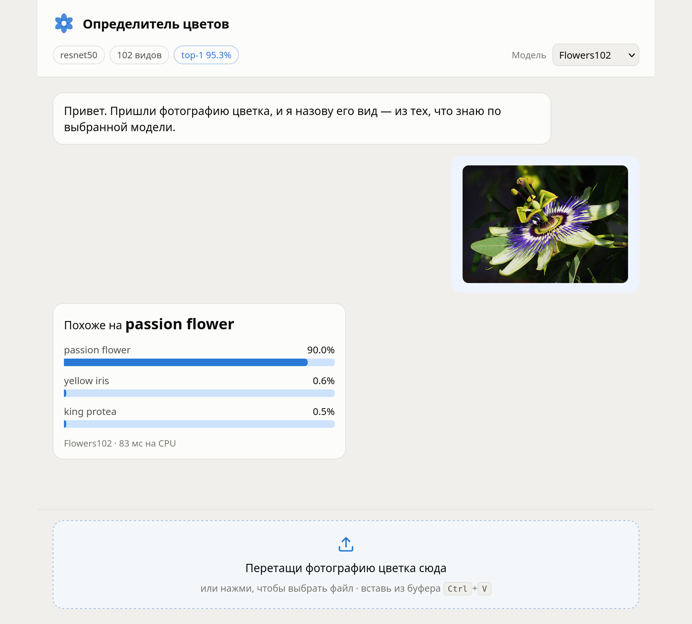

# Flower identifier

Send a photo of a flower and get its species back, with the three most likely
candidates and their probabilities. The model is trained in Google Colab on a
GPU but runs on an ordinary CPU: the server depends on `onnxruntime` alone —
neither torch nor torchvision is installed. The interface speaks English and
Russian.



## Running it

You need Python 3.11+, Node 20+ and [uv](https://docs.astral.sh/uv/).

```bash
git clone https://github.com/issToma/what-the-flower.git
cd what-the-flower
uv sync
cd frontend && npm install && npm run build && cd ..
uv run uvicorn app.main:app --port 8000
```

Open http://127.0.0.1:8000 — FastAPI serves the built frontend itself.

With no weights in `model/` the page still opens and says the model is
missing. The next section is about getting them.

## Models

Training lives in two Colab notebooks:

| Notebook | Dataset | Species | top-1 | Time on a T4 |
|---|---|---|---|---|
| `train_flowers102_colab.ipynb` | Flowers-102 | 102 | 95.3% | ~10 min |
| `train_plantnet100_colab.ipynb` | Pl@ntNet-300K, a slice | 100 | 79.2% | ~40 min |

The second model scores lower because of the data, not the training: Pl@ntNet
is field photos taken on phones, with a long tail of rare species — its
average over species is only 55.5%.

Open a notebook in Colab, enable the GPU (`Runtime` → `Change runtime type`)
and `Run all`. At the end it offers two files to download — drop them into
`model/` as they are:

```
model/
  flowers102.onnx  + flowers102.labels.json
  plantnet100.onnx + plantnet100.labels.json
```

There can be any number of models, each a pair of files sharing a name. With
more than one the header grows a picker; the label comes from the `dataset`
field inside the description. A newly added model is picked up on restart.

## How it works

```
app/         FastAPI: preprocessing, inference, API
frontend/    React + Vite: the chat
notebooks/   training and ONNX export
model/       weights (never committed)
tests/       preprocessing, API contract, security regressions
```

ImageNet normalisation and softmax are baked into the ONNX graph, so the
server only has to resize the image and crop the centre — preprocessing
cannot drift away from what training did. The notebook verifies this before
exporting, comparing torch and onnxruntime outputs on one batch.

Inference takes about 100 ms and runs in a thread pool, so parallel requests
do not queue behind each other. Graphs are loaded on first use: each one takes
around 100 MB of memory.

## API

| Method | Path | |
|---|---|---|
| `GET` | `/api/health` | readiness and the number of models found |
| `GET` | `/api/models` | models with architecture, class count and accuracy |
| `POST` | `/api/predict` | `multipart/form-data`: `image` and optional `model` |

```json
{
  "model": "flowers102",
  "top": [{"label": "sunflower", "probability": 0.912}, ...],
  "uncertain": false,
  "latency_ms": 136.7
}
```

`uncertain` is raised when the best guess scores below 0.25: a model only
knows its own list of species and will still name three of them for an
unrelated photo, so the interface says so out loud.

Errors carry a machine-readable `code` next to the English `detail`, which is
what lets the interface show them in the language the visitor picked:

```json
{"code": "too_large", "detail": "the file is larger than 10 MB"}
```

## Development

The backend with reload, and Vite in another terminal (it proxies `/api` to
port 8000, so no CORS setup is needed):

```bash
uv run uvicorn app.main:app --reload --port 8000
cd frontend && npm run dev              # http://127.0.0.1:5173
```

The tests run without trained weights — they build a toy ONNX model with the
same contract. GitHub Actions runs them on every push.

```bash
uv sync --group dev
uv run pytest
```

## Before exposing it to the internet

This is meant to run locally: `uvicorn` listens on `127.0.0.1`, and there is
no authentication and no rate limiting. Facing the internet it needs a reverse
proxy with a body size limit (`client_max_body_size 10m`) and a rate limit —
one inference costs about 100 ms of CPU time.

One more thing: somebody else's `.onnx` file is not data, it is an executable
graph. Trust it the way you would trust code.

## Licences

The code is MIT. The datasets belong to their authors and come with their own
terms: [Flowers-102](https://www.robots.ox.ac.uk/~vgg/data/flowers/102/)
(Visual Geometry Group, Oxford) and
[Pl@ntNet-300K](https://zenodo.org/records/4726653) (CC BY-SA 4.0). Weights
trained on them are not covered by this repository's licence.
